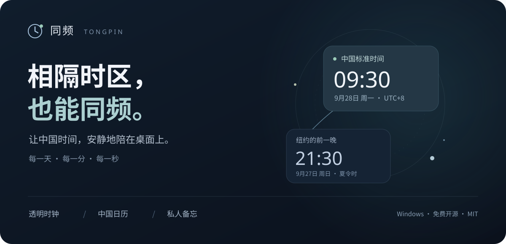
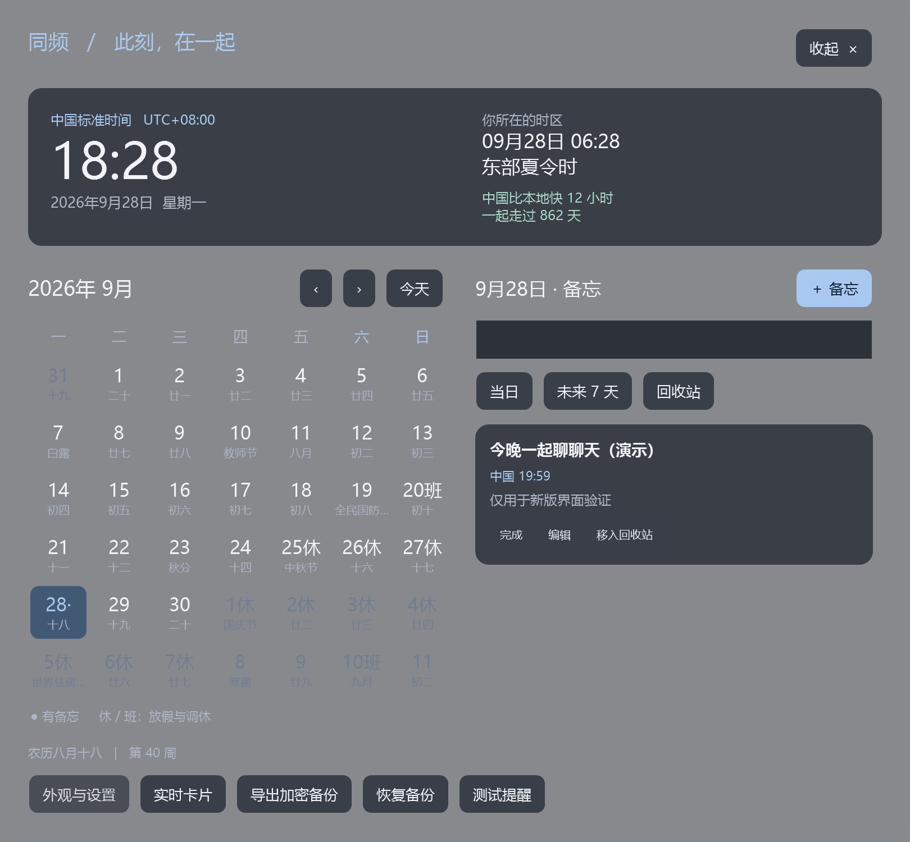
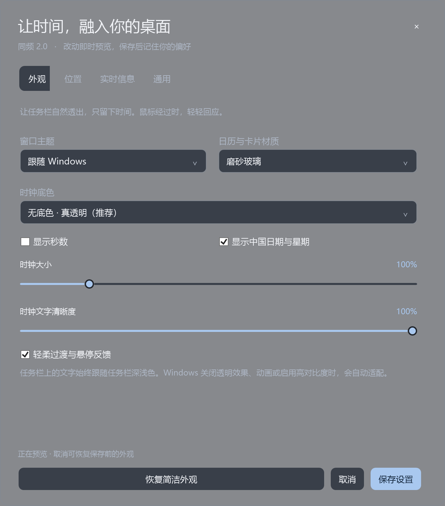
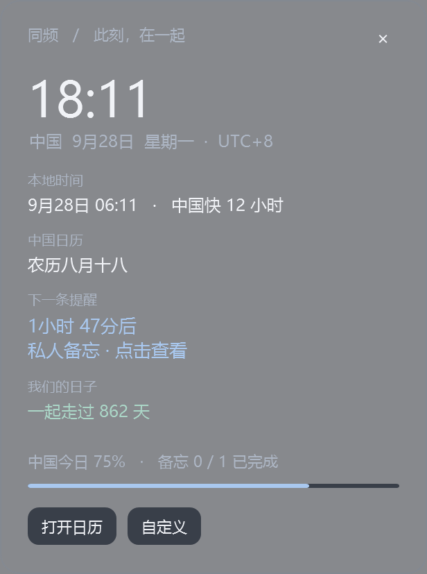
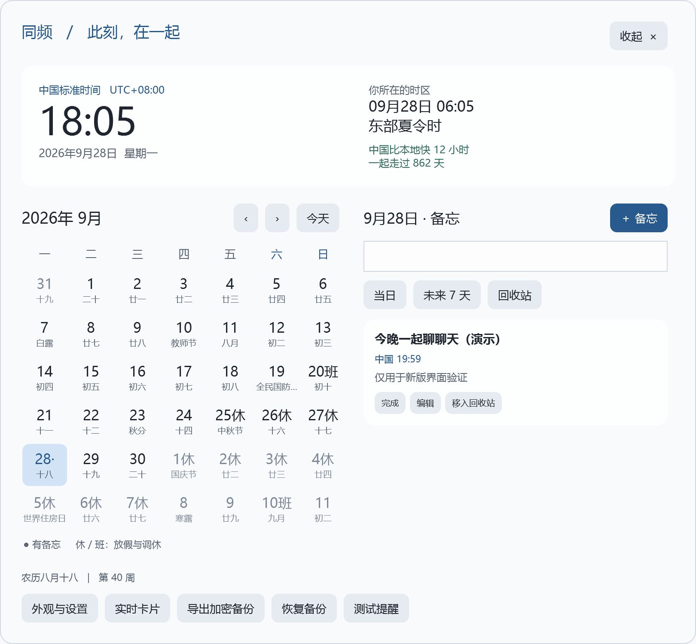
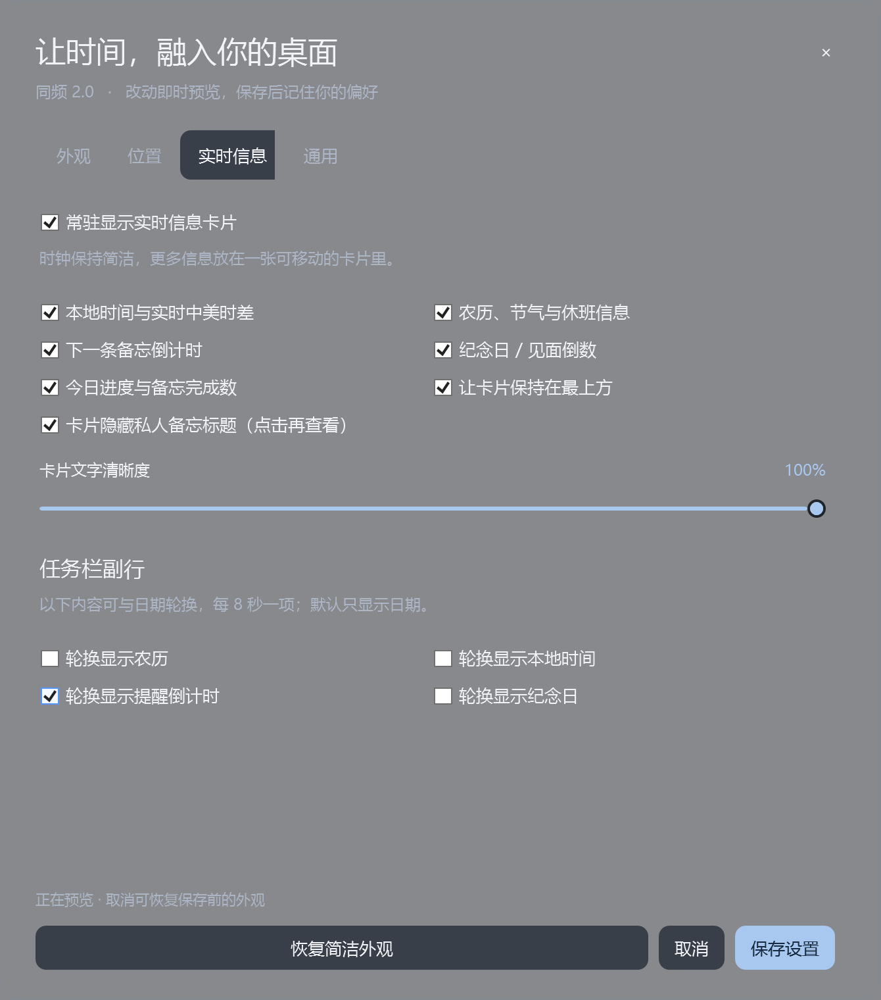

<div align="center">



# 同频 · Tongpin

**相隔时区，也能同频。**

让中国时间，安静地陪在桌面上。<br>
每一天、每一分、每一秒，和在意的人共用同一份时间。

[](https://github.com/songchao-bstvc/Tongpin-ChinaTime/releases/latest)
[](#下载与开始使用)
[](LICENSE)
[](https://github.com/songchao-bstvc/Tongpin-ChinaTime/actions/workflows/build.yml)
[](https://github.com/songchao-bstvc/Tongpin-ChinaTime/stargazers)

### [⬇ 下载 Windows 版](https://github.com/songchao-bstvc/Tongpin-ChinaTime/releases/latest/download/Tongpin-ChinaTime-v2.0.0-windows-x64.zip) · [查看使用指南](docs/QUICK_START.md) · [反馈与许愿](https://github.com/songchao-bstvc/Tongpin-ChinaTime/issues)

中文界面 · 透明时钟 · 农历日历 · 私人备忘 · 本地加密 · 免费开源

</div>

---

## 为什么做同频？

**人在海外，心里装着中国的某个人。**

电脑上的早晨，也许是爱人的傍晚。家人的生日、朋友的约定、想说一声晚安的时刻，不该每次都先算一遍时差。同频把中国时间放在你抬眼就能看到的地方，让远方的日常离你近一点。

**人在中国，电脑却需要用海外时区。**

跨国工作、测试环境或海外业务让系统必须保持国外时区，但开会、出门、生活安排仍然按中国时间进行。有时，屏幕上甚至还是“昨天”。同频独立显示中国的时间、日期和日历，减少跨日看错、日程填错的困扰。

> **系统时区随工作，生活节奏在中国。**
>
> 例如：纽约处于夏令时的 9 月 27 日 21:30，中国已是 9 月 28 日 09:30。打开电脑，直接看见中国的“今天”。本地时区的夏令时变化由系统时区规则处理。

同频是一款 **Windows 桌面小工具**：保留你的系统时区，让任务栏或桌面常驻中国标准时间（UTC+8），点击即可打开中文日历和按日备忘。所有核心功能均在本地运行，无需注册账号。

## 看见时间，也记住日子

<p align="center">
  
</p>

<p align="center"><em>中国与本地时间同屏，农历、节气、休班与每日备忘集中呈现。</em></p>

| 你想要的 | 同频怎么做 |
| --- | --- |
| 抬眼就知道中国几点、哪一天 | 时间、日期和星期常驻显示；默认两行极简，无“中国”前缀，秒数可选 |
| 融入桌面，不突兀 | 时钟逐像素透明，文字跟随任务栏深浅色；日历和卡片支持磨砂玻璃、圆角与轻柔反馈 |
| 放在自己顺手的位置 | 任务栏右侧、左下、右下、上方、居中或自由拖动，支持选择显示器 |
| 记得和家人、爱人的约定 | 每日私人备忘、到点提醒、稍后 10 分钟、完成标记、搜索与回收站 |
| 中国的“今天”始终清楚 | 月历、农历、节气、传统节日，以及内置的放假与调休数据 |
| 多一点陪伴感 | 可选纪念日、见面倒数、下一条备忘倒计时、今日进度 |
| 需要时丰富，平时保持安静 | 实时卡片与任务栏轮换信息逐项勾选，默认只显示中国时间和日期 |
| 私事留在自己电脑里 | Windows 当前用户加密存储、每日自动备份、带密码的导出与恢复 |

## 三步，让桌面和你同频

| ① 看见中国时间 | ② 留下一个约定 | ③ 按你的习惯显示 |
| :--- | :--- | :--- |
| 解压后运行 `ChinaTime.exe`，任务栏出现极简时钟。 | 点击时钟 → 选择日期 →「＋ 备忘」，按中国时间设置提醒。 | 右击时钟 →「外观、位置与实时信息」，调整主题、位置和卡片。 |
| `18:30`<br>`9月28日 周一` | “今晚 20:00，和家人视频”<br>“周五 18:30，记得出门” | 想简洁就只留时间；想丰富再勾选农历、倒计时和纪念日。 |

**默认极简，细节由你决定。** 中国时间每秒更新；默认隐藏秒数，打开「显示秒数」即可显示到秒。点击时钟展开日历，按 `Esc` 收起，提醒继续在后台运行。

<table>
  <tr>
    <td width="65%" align="center"><strong>让时间融入你的桌面</strong></td>
    <td width="35%" align="center"><strong>把在意的日子放在身边</strong></td>
  </tr>
  <tr>
    <td valign="top"></td>
    <td valign="top"></td>
  </tr>
</table>

<details>
<summary><strong>☀️ 看看浅色日历与可选实时信息</strong></summary>





</details>

截图由应用在 Windows 上实际运行时导出，使用虚构的演示备忘与纪念日；不同截图的时间不同。窗口内容截图不包含 Windows 合成的背景模糊层，实机玻璃效果会随系统和背景变化。封面为品牌插画。

## 下载与开始使用

**推荐环境：Windows 11 x64，.NET Framework 4.8 或更高版本。** 已在 Windows 11 23H2、4K / 200% 缩放环境验证；Windows 10、ARM64 和其他布局尚未完成完整实机验证。

1. 在 [Releases](https://github.com/songchao-bstvc/Tongpin-ChinaTime/releases/latest) 下载 **`Tongpin-ChinaTime-v2.0.0-windows-x64.zip`**。普通用户不需要下载 `Source code`。
2. **完整解压**到你准备长期保留的文件夹，双击 `ChinaTime.exe`。无需安装程序，无需管理员权限。
3. 打开「外观与设置 → 通用」，勾选「登录 Windows 后自动显示中国时钟」，保存。以后登录 Windows 桌面后自动显示。

程序是便携分发；备忘与设置存放在当前 Windows 用户的数据目录，**不随 EXE 文件夹一起移动**。升级前建议导出加密备份。更换程序目录后，请重新设置登录启动。

<details>
<summary><strong>首次运行、任务栏位置、关闭与卸载</strong></summary>

- 当前发行版没有商业代码签名证书，Windows 可能提示“未知发布者”。请核对下载来源与发行页中的 SHA-256；是否运行由你决定。
- 同频在任务栏上创建独立的透明时钟窗口；可识别原生时钟时对齐其区域，原生时钟隐藏时尝试托盘左侧空白，拥挤时退到任务栏上缘。特殊任务栏工具或布局可能影响定位，可在设置中改用桌面位置。
- 默认锁定位置，按住 `Ctrl` 可拖动；也可在位置设置中解除锁定。
- 收起日历会继续运行。要完全结束，请右击时钟或托盘图标 →「退出同频」。
- 停用：先取消登录启动，再退出。删除解压目录即可移除程序；私人数据默认保留，方便以后恢复。

</details>

更多操作见 **[中文使用指南](docs/QUICK_START.md)**。

## 备忘与提醒，跟着中国日期走

- 日期、提醒时间均按中国标准时间填写；编辑时会显示对应的本地时间。
- 支持单次、每天、每周一至周五、每周、每月同日、每年同日（公历）。不存在的日期会跳过，例如平年的 2 月 29 日。
- 提醒可选「已完成」「稍后 10 分钟」「知道了」，也可打开对应日期的日历。
- 支持未来 7 天、标题与正文搜索、回收站恢复。
- 卡片上的私人标题默认隐藏；提醒窗口也可在设置中隐藏标题。

**运行边界：** 提醒约每 10 秒检查一次。关机、休眠、锁屏或程序退出时不会弹出；恢复运行后处理遗漏提醒，重复提醒最多回看 7 天并合并为最近一次。应用不会唤醒电脑，也不会向手机发送通知。

时钟根据电脑当前 UTC 换算，不连接在线授时服务。如果电脑自身时间不准，需要修正 Windows 时间同步。农历和节气离线计算；**法定放假/调休数据目前到 2026 年**。每周一至周五重复不等于中国法定工作日，年度重复目前按公历。

## 私人备忘，留在本地

应用不包含账号系统、云同步、广告、运行时联网服务或遥测。数据保存在 `%LOCALAPPDATA%\TongpinChinaTime`，以 Windows DPAPI 当前用户方式加密；同一 Windows 账户下运行的其他程序仍可能访问，不能把它视作独立保险箱。

每日自动备份适合本机回档；**换电脑或重装系统前，请在日历中「导出加密备份」并妥善保存密码**。详细数据位置、恢复规则与保护范围见 [隐私与备份说明](docs/PRIVACY.md)。

## 开源，也欢迎你一起完善

同频使用 **[MIT License](LICENSE)**，允许使用、修改、分发和商用，请保留版权及许可声明。特别感谢：

- [DesktopClock](https://github.com/danielchalmers/DesktopClock)：时钟计时器与日期工具。
- [lunar-csharp](https://github.com/6tail/lunar-csharp)：农历、节气、传统节日与休班资料。

第三方版本及完整许可见 [THIRD_PARTY_NOTICES.md](THIRD_PARTY_NOTICES.md)。同频是独立项目，不是上述项目的官方发行版。

**从源码构建**：Windows x64 + PowerShell 7.2 或更高版本 + .NET Framework 4.8。构建使用 PowerShell 随附的 Roslyn 编译器；源码中的第三方组件已固定版本，无需在线下载 NuGet 包。

```powershell
git clone https://github.com/songchao-bstvc/Tongpin-ChinaTime.git
cd Tongpin-ChinaTime
pwsh -NoProfile -File scripts/build.ps1
pwsh -NoProfile -File scripts/test.ps1
pwsh -NoProfile -File scripts/package.ps1
```

输出：`build/ChinaTime.exe`、`dist/` 便携 ZIP 与 SHA-256 校验文件。24 项核心自检覆盖跨日、夏令时、农历节日、提醒与重复边界、加密备份、数据兼容和主题切换；CI 不能代替任务栏与多屏实机验收。详见 [开发与验证](docs/DEVELOPMENT.md) 和 [参与贡献](CONTRIBUTING.md)。

优先欢迎：不同显示器与缩放比例反馈、任务栏兼容、无障碍改进、后续年份休班数据更新。手机同步、农历生日重复等属于可讨论的未来方向，尚未实现。

---

<div align="center">

**如果这个小工具，让你想起了某个远方的人，给同频一颗 ⭐ 吧。**

也欢迎把它分享给海外的朋友、异地的爱人，或需要两套时区的同事。<br>
愿我们各自忙碌，也能同频每一天。

[下载同频](https://github.com/songchao-bstvc/Tongpin-ChinaTime/releases/latest) · [报告问题](https://github.com/songchao-bstvc/Tongpin-ChinaTime/issues/new?template=bug_report.yml) · [提出想法](https://github.com/songchao-bstvc/Tongpin-ChinaTime/issues/new?template=feature_request.yml)

<sub>Tongpin is a free, open-source Windows China-time clock, lunar calendar and private reminder app. Stay in sync with the people you care about, wherever you are.</sub>

</div>
